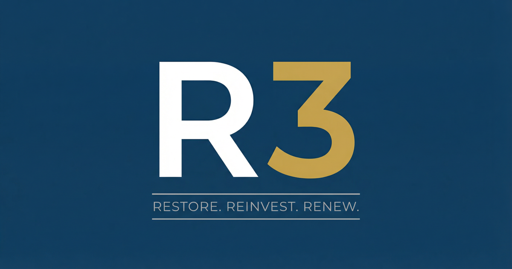

# ICJIA R3 Program Website



[](./LICENSE.md)


Official website for Illinois' R3 (Restore, Reinvest, Renew) program.

🌐 **Live Site**: [https://r3.illinois.gov](https://r3.illinois.gov)

---

## Stack

- **Framework**: Astro 6 (`output: 'static'`), Tailwind CSS 4 via `@tailwindcss/vite`
- **Islands**: Vue 3 via `@astrojs/vue` — only the Search, Dialog, and Contact
  form hydrate; every other component ships zero JavaScript
- **Content**: live Strapi (`r3.icjia-api.cloud`) + Research Hub
  (`researchhub.icjia-api.cloud`) GraphQL, fetched and zod-validated at build
  time — no markdown fixtures on disk, no prebuild step
- **Hosting**: Netlify (build base = `astro/`)
- **Analytics**: Plausible (`plausible.icjia.cloud`)

## Quick start

```bash
cd astro
nvm use         # Node 22.22.2
yarn install
yarn dev        # http://localhost:4321
yarn build      # writes astro/dist/
yarn preview    # serves astro/dist/
yarn test       # vitest unit tests
yarn test:e2e   # playwright e2e (mobile / tablet / desktop)
./scripts/check-all.sh   # full pre-push gate: check + test + build + e2e
```

## Project structure

- `astro/` — the website source (this is the entire app)
- `astro/CHANGELOG.md` — granular per-release changelog
- `astro/MIGRATION.md` — per-phase migration record (baselines, verification)
- `docs/superpowers/specs/` — design spec
- `docs/superpowers/plans/` — implementation plan
- `netlify.toml` — Netlify build config + security headers (build base `astro/`)

## Standards

- **Mobile Lighthouse Performance**: ≥ 95 on every route
- **Accessibility**: 100 on every route — WCAG 2.1 AA, IITAA, ADA Title II
- **Best Practices**: 100 on every route
- **SEO**: 100 on every route

## Accessibility

Accessibility is verified four ways:

- **axe-core sweep (e2e)** — `tests/e2e/a11y-sweep.spec.ts` runs axe-core
  (`wcag2a`, `wcag2aa`, `wcag21a`, `wcag21aa`) against every route in the
  emitted `sitemap.xml`, across mobile / tablet / desktop viewports, on
  every build.
- **axe-core via `axecap`** — sitemap-wide AA audit via the `axecap` MCP
  runner.
- **Lighthouse via `lightcap`** — accessibility score audited per route,
  both desktop and mobile viewports.
- **`contrastcap` pixel sampling** — resolves axe-core's "needs review"
  verdicts on text-over-image regions by sampling the actual rendered
  pixels behind each text node and computing the real WCAG ratio. The only
  tool of the four that can give a definitive answer when text sits on a
  photographic background (the homepage `.splash-card` and `.photo-box`).

The full audit results and any mitigations are recorded below — see
[**Accessibility audit results**](#accessibility-audit-results).

### Accessibility audit results

Most recent comprehensive sweep — every route in the built `sitemap.xml`
audited via four independent tools:

| Tool | Coverage | Result |
|------|----------|--------|
| axe-core via `axecap` (level AA) | 25 sitemap pages, desktop | **0 violations** |
| axe-core via Playwright (`a11y-sweep.spec.ts`) | 26 routes × 3 viewports = 78 scans | **0 violations** |
| Lighthouse via `lightcap`, desktop | 25 sitemap pages | **100 / 100 every route** |
| Lighthouse via `lightcap`, mobile | 5 representative pages incl. `/eligibility/`, `/contact/` | **100 / 100 every route** |
| `contrastcap` pixel sampling | homepage (text-over-image regions) | **0 failures**, lowest sampled ratio **6.11:1** |

Tags audited: `wcag2a`, `wcag2aa`, `wcag21a`, `wcag21aa`. The e2e sweep
runs on every build and hard-fails on any violation. The current sweep is
clean across all four tools.

**Live published report.** The latest sweep is published as a styled
per-route × per-viewport report at
[`/documentation/accessibility/`](https://r3.illinois.gov/documentation/accessibility/),
regenerated by [`astro/scripts/generate-a11y-report.mjs`](astro/scripts/generate-a11y-report.mjs)
(Playwright + axe-core 4.11). Format modeled on
[`dvfr.illinois.gov/docs/accessibility/`](https://dvfr.illinois.gov/docs/accessibility/).

**Mitigations applied during the Astro rebuild** (full detail in
`astro/MIGRATION.md`):

| Issue | WCAG | Fix |
|-------|------|-----|
| `HomeSplashCard` `aria-label` omitted the visible date text | 2.5.3 (A) | Dropped the redundant `aria-label`; the link's visible text is its accessible name |
| `/news/` card titles jumped `h1` → `h3` | 1.3.1 / best-practice | `NewsCard` gained a `headingLevel` prop; `/news/` passes `h2` |
| `Dialog.vue`'s `<Teleport>` destroyed the skip-links `<nav>` on `client:idle` hydration, site-wide | 2.4.1 (A) | Removed the `<Teleport>` — a native `<dialog>` + `showModal()` is top-layer-promoted and never needed it; regression test added |
| `HomePhotoBoxes` description text failed 4.5:1 over bright photos (FAQs 3.38:1, Collaboratives 3.62:1) | 1.4.3 (AA) | Pixel-sampled by `contrastcap`. Strengthened the gradient overlay endpoint from `rgba(0,0,0,0.1)` to `rgba(0,0,0,0.5)` — all over-image text now sits at ≥6.11:1 worst case while keeping the photo's character. axe-core can't pixel-sample over images and reports these as "needs review"; `contrastcap` is the authoritative measure |

Compliant with **WCAG 2.1 AA**, **IITAA** (Illinois state standard), and
**ADA Title II**.

## Security

The site inherits the security posture established in the March 2026 red-team
review and carried through the Astro rebuild:

- **Static generation** — no runtime server, eliminating SQL injection, RCE,
  and most server-side attack surface
- **Content-Security-Policy + hardened headers** — CSP, `X-Frame-Options`,
  `X-Content-Type-Options`, `Referrer-Policy`, `X-XSS-Protection` are set in
  `netlify.toml`; no `'unsafe-eval'`, no CORS wildcard
- **HTML sanitization** — all Strapi-sourced markdown is rendered through
  `markdown-it` + DOMPurify; iframes are whitelisted to ArcGIS domains only
- **No authentication surface** — no accounts, sessions, or credentials
- **Privacy-first analytics** — Plausible (no cookies, no personal data)
- **Whitelisted origins** — image and `connect-src` origins are restricted to
  approved hosts via the CSP

## Migration history

This site was rebuilt from Nuxt 4 + Vuetify 3 to Astro 6 + Tailwind 4 over
ten migration phases (v0.1.0 – v0.10.0). The cutover landed on
**2026-05-23**: `main` was force-replaced with the Astro tip and Netlify
rebuilt production from the new tree. See:

- [`astro/CHANGELOG.md`](./astro/CHANGELOG.md) — granular per-release record,
  starting with the cutover entry at the top
- [`astro/MIGRATION.md`](./astro/MIGRATION.md) — per-phase baselines and
  verification results (incl. the Nuxt P0 Lighthouse table)
- [`MIGRATION_PLAYBOOK.md`](./MIGRATION_PLAYBOOK.md) — lessons-learned
  jumpstart guide for the next ICJIA Nuxt-to-Astro migration
- `docs/superpowers/specs/` — original design spec
- `docs/superpowers/plans/` — phase-by-phase implementation plan

The pre-cutover Nuxt 4 `main` is preserved at the **`pre-astro-cutover`**
git tag (and on the historical `feat/nuxt4-migration` branch). The
**`v0.10.0`** tag marks the cutover commit on `main`.

### Mobile Lighthouse — Nuxt vs Astro (cutover day measurement)

| Route | Nuxt P0 | Astro | Δ |
|---|---:|---:|---:|
| `/` | 63 (LCP 6.8s) | **100** (LCP 1.7s) | **+37** |
| `/eligibility/` | 59 (LCP 14.1s) | **90** | **+31** |
| `/collaboratives/` | 68 | **98** | **+30** |

A11y / Best Practices / SEO held at 100 across the categories audited.

---
*Maintained by the ICJIA Web Development Team.*
